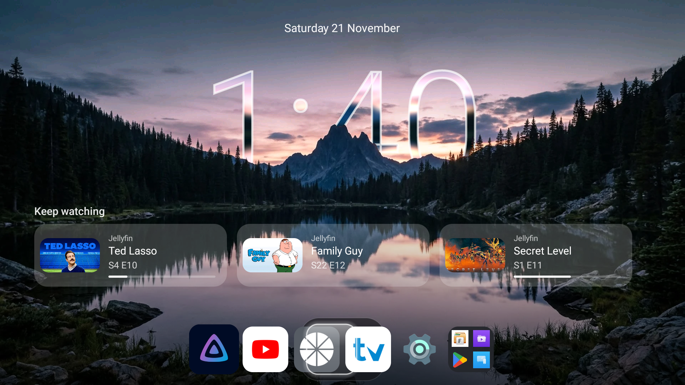
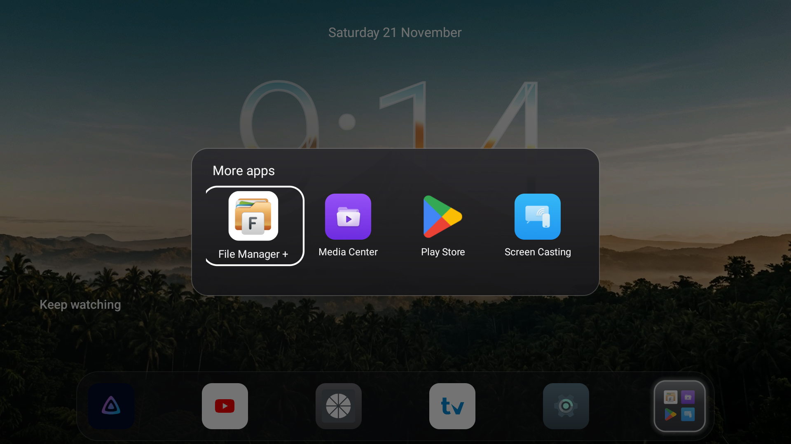
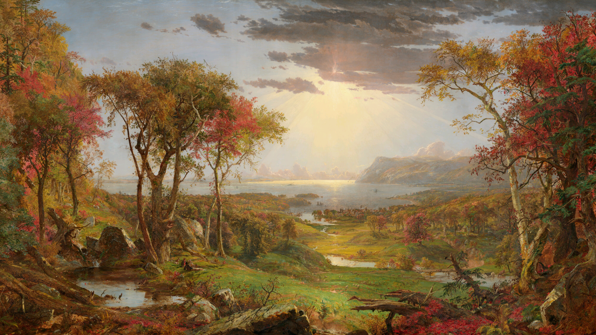

# Living room

<p align="center">
  
</p>

A home screen for the living-room TV. A landscape fills the screen, a frosted clock sits in the
sky, and the dock is a short row of the apps' own icons. Keep watching shows the episode and how
far through it you are. After a quiet minute, or two presses of Back, a painting takes over.

This is our launcher. It is built on [CleanYourTV](https://github.com/Gathin23/cleanyourtv),
which is where the plain dock, the theme file, and the per-TV notes come from. The scenic home
is in this tree. A stock CleanYourTV install does not have it.

The long version, including the Hisense 75U75N limits, is [docs/scenic-home.md](docs/scenic-home.md).
To put this same home on another TV, an assistant follows [docs/install.md](docs/install.md).

## What you see

The date is centered. The clock is glass, and the treeline cuts across the lower digits. There
is no greeting and no row of buttons in the corner.

Keep watching is up to three glass cards for whichever dock app is focused. Each card is the
same height: a picture, the app, the title, the episode, and a progress bar. When that app has
published nothing, the row and its heading both go away.

The dock wraps its icons. It stays narrow when there are only a few, and it will not grow past
about 680dp. Settings is an icon on the dock. The last icon opens More apps, which launches
anything that is not already on the dock. OK in that folder opens the app.

<p align="center">
  
</p>

Pressing Back twice within two seconds starts the screensaver. One press does nothing. The first
key after that brings the clock and the dock back, and does not open an app.

<p align="center">
  
</p>

## Build and install

JDK 17. Gradle 8.9 does not build on JDK 25. `ANDROID_HOME` is the Android SDK.

```powershell
cd launcher
$env:JAVA_HOME = '<jdk 17>'
$env:ANDROID_HOME = "$env:LOCALAPPDATA\Android\Sdk"
.\gradlew.bat assembleRelease --console=plain
adb connect <tv-ip>:5555
adb -s <tv-ip>:5555 install -r app\build\outputs\apk\release\app-release.apk
adb -s <tv-ip>:5555 shell am force-stop com.gathin.tvhome
adb -s <tv-ip>:5555 shell am start -a android.intent.action.MAIN -c android.intent.category.HOME -n com.gathin.tvhome/.MainActivity
powershell -ExecutionPolicy Bypass -File ..\tools\theme.ps1 -TvHost <tv-ip> ..\themes\living-room
```

The installed APK is already this home: the landscape, the glass clock, the short icon dock,
and the paintings. No theme file is required for that. `themes/living-room/config.json` only
changes a house: which apps are on the dock, and an optional XMLTV address for the sports row.
Change `dock_apps` and `sports_epg` for another house before pushing it. The guide address is
not part of this repo. Skipping that push leaves the dock as the apps built into the APK.

## Updates

When the launcher starts, it asks GitHub once for the latest release of this repo. Coming
back to Home does not ask again. The tag is the version code (`v9`) and the release includes
the APK. A newer tag opens a prompt. The TV still asks before it replaces Home.

The repo is public, so the TV needs no token. A theme that points `update_repo` at a private
repo can put a read token alone in `update-token` next to the theme, or set `update_token`.
Do not commit it.

```powershell
gh release create v9 app\build\outputs\apk\release\app-release.apk --repo lsands65/tv-home --title "2.8"
```

Set `versionCode` and `versionName` in `launcher/app/build.gradle` to match before building
that APK.

## Paintings and scenes

The idle paintings are National Gallery of Art open-access images at the gallery's 4096px cap.
Credits are in `launcher/app/src/main/assets/art/CREDITS.md`. The five backgrounds are the
Couch TV night scenes, used at 1920x1080. Their note is in the scenic home guide.

Open More apps and choose Screensaver. Art, Aerials, Photos, or All. Aerials are Apple's TV
aerials, the landscape films, full screen, one place after another. The same screen sets how
long the home waits, how often the landscape changes, and how often a painting or photo
changes. Photos and All show a QR code: leave that screen open, scan it with a phone, and
send jpeg, png, or webp pictures. They stay on the TV. Closing the screen turns the page off.
